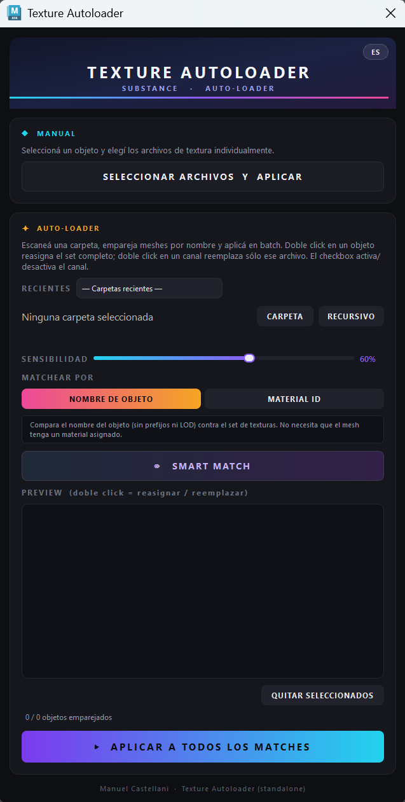
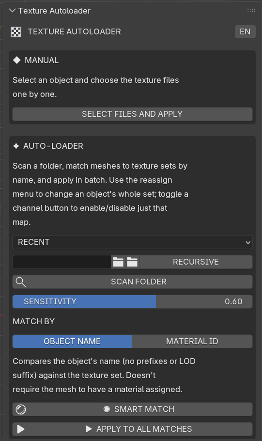

# Texture Autoloader

*[Leer en español](README.es.md)*

A texture auto-loader for Maya (Arnold) and Blender. Point it at a
folder of Substance-exported textures, and it fuzzy-matches each mesh in
your scene to the right texture set by name — or by the material it
already has assigned — then wires a shader for you: `aiStandardSurface`
in Maya, a Principled BSDF node graph in Blender.

This exists because re-wiring shading networks by hand after every
Substance export is repetitive, error-prone, and doesn't scale past a
handful of assets. Texture Autoloader turns "reconnect 8 texture maps
per object, for 40 objects" into "scan a folder, review the matches,
click Apply."

|                Maya                |               Blender                |
|:-----------------------------------:|:-------------------------------------:|
|  |  |

## What it actually does

1. **Scan** a folder (optionally recursive) for texture files, grouping
   them into sets by their base asset name (stripping map-type suffixes
   like `_BaseColor`, `_Roughness`, resolution/UDIM modifiers, etc.).
2. **Match** each selected mesh to a texture set, either by the mesh's
   own name or by the name of the material already assigned to it (with
   automatic fallback to name-matching if the mesh has no material of
   its own yet). Matching is fuzzy (typo/substring tolerant) with an
   adjustable sensitivity threshold.
3. **Preview** the match per object, per channel, before touching the
   scene — disable a channel you don't want, or manually reassign a
   texture set or a single file.
4. **Apply**: creates a new shader per object and wires baseColor,
   roughness, metallic, normal, emission, ambient occlusion (multiplied
   into base color), opacity, and — opt-in only — displacement.
5. **Report** what happened, per file: `✔` wired, `✘` no match / no input
   for that channel / error, `–` deliberately skipped (channel turned
   off, displacement opt-in, a duplicate of a map already used), plus the
   texture sets no object claimed.

```
SM_Rock  →  Rock  (95%)  ·  M_Rock_MAT
    ✔ Rock_BaseColor.png → baseColor
    – Rock_Height.png → displacement: not wired, displacement is opt-in
    ✘ no match: Rock_Curvature.png
```

**Render engine (Maya)**: Arnold, Redshift or V-Ray, picked in the UI.
What changes per engine is only which shader to create and which input
each channel goes to — one template per engine, not a different tool.
Every attribute is checked before connecting, so a name that doesn't
exist in your renderer version shows up as `✘` in the report instead of
breaking the batch. Blender needs no selector: the Principled BSDF
covers both Cycles and EEVEE.

**Naming presets**: studios customize Substance's export suffixes
(`_BaseColor` vs `_Albedo` vs `_BC`). Instead of editing `map_types` by
hand, name your convention once in the config and pick it in the UI.
Preset suffixes are matched at the *end* of the file name, so short ones
are safe: `Rock_R.png` is roughness, while `Car_Rim_BC.png` is base
color and not roughness because it contains `_R`.

## Why displacement is opt-in, and why UDIM detection has a denylist

Two decisions worth knowing about before you use this on a real asset:

- **Displacement deforms actual render geometry.** Wiring a
  height/displacement map without a hand-tuned displacement scale and
  mesh subdivision leaves the object looking inflated. This tool detects
  displacement maps and reports them, but does **not** wire them unless
  you explicitly turn on `enable_displacement_wiring` in the config.
- **UDIM detection is bounded to tile numbers 1001–1999, with a denylist
  of common resolution suffixes** (512, 1024, 2048, 4096, 8192, 16384).
  Without this, two exports of the same map at different resolutions
  (e.g. `Wall_BaseColor_1024.png` and `Wall_BaseColor_2048.png`) get
  misread as UDIM tiles, which breaks tiling in the renderer.

Both of these came from hitting the actual failure mode in production
and are documented in more detail in the code comments where they're
implemented.

## Repository structure

```
TextureAutoloader/
├── maya/
│   └── texture_autoloader_maya_standalone.py     # paste into the Script Editor and run — that's it
├── blender/
│   └── texture_autoloader_blender_standalone.py  # Install... this one file — that's it
├── advanced/                       # modular build — see "Advanced / modular build" below
│   ├── core/
│   │   └── texture_autoloader_core.py
│   ├── maya/
│   │   ├── texture_autoloader_maya.py
│   │   ├── install_shelf_button.py
│   │   └── tests/
│   ├── blender/
│   │   └── texture_autoloader_blender.py
│   └── tests/
├── unreal/                         # Unreal Engine port — see unreal/README.md
├── tests/                          # integration tests that run inside a real Maya / Blender / Unreal
├── build_standalone.py             # generates the two single-file builds from advanced/
├── LICENSE
└── .gitignore
```

The two single-file builds are **generated** from `advanced/` by
`build_standalone.py` — they used to be hand-made copies, and they
drifted. Fix things in `advanced/`, run the script, commit both.

If you just want to use the tool, everything you need is the single
file in `maya/` or `blender/` above — nothing else in this repo matters
to you. `advanced/` holds a second, modular build of the exact same
tool, kept only for people extending or maintaining the matching logic
itself; skip straight to [Advanced / modular build](#advanced--modular-build)
if that's you, otherwise ignore that folder entirely.

## Installation

### Maya

Open `maya/texture_autoloader_maya_standalone.py`, copy the whole file,
paste it into Maya's Script Editor (Python tab), and run it — the tool
opens immediately, no dialogs, no folder to pick, ever. Paste it again
any time you want to reopen it. Its config/state/log files live in
Maya's own per-user preferences folder rather than "next to the
script," since a pasted script has no folder of its own.

### Blender

In Blender: **Edit > Preferences > Add-ons > Install...**, pick
`blender/texture_autoloader_blender_standalone.py`, enable it. Open the
3D Viewport's Sidebar (press `N`) — there's a **Texture Autoloader**
tab.

Both files are fully self-contained (single file, no imports from the
rest of this repo) — that's the whole install.

## Advanced / modular build

Everything below this point is only relevant if you're going to modify
the matching/naming logic itself, want Maya and Blender to always stay
perfectly in sync on that logic, or want to run the automated test
suite. If you just want to use the tool, you don't need any of this —
see Installation above.

The modular build lives in `advanced/`: `advanced/core/texture_autoloader_core.py`
has **zero dependencies on Maya, Blender, or any GUI toolkit**. Name
normalization, fuzzy matching, UDIM collapsing, map-type bucketing,
config/state persistence, logging, and the English/Spanish translation
table all live there, shared by both front-ends
(`advanced/maya/texture_autoloader_maya.py` and
`advanced/blender/texture_autoloader_blender.py`). Each front-end only
adds what's genuinely specific to its host application: the actual
shader-node wiring, and the UI. This is also why the two UIs can never
drift out of sync on translated strings — they read from the same
table. The two single-file builds under `maya/` and `blender/` inline
this same logic by hand and are not generated from it, so a change made
here needs to be manually ported to those files too.

### Installing the modular build

**Maya** — keep `advanced/`'s folder structure intact
(`advanced/maya/texture_autoloader_maya.py` needs its sibling `core/`
folder) and either add `advanced/maya/` to your Maya script path and run
```python
import texture_autoloader_maya as ta
ta.create_ui()
```
or use the one-time shelf installer, `advanced/maya/install_shelf_button.py`
(paste it into the Script Editor and run it once — it asks you to pick
the `TextureAutoloader/advanced` folder, then adds a shelf button so
future runs are a single click). **Don't paste
`advanced/maya/texture_autoloader_maya.py` itself directly into the
Script Editor** — it depends on finding its sibling `core/` folder on
disk, which a pasted script can't do; use `maya/texture_autoloader_maya_standalone.py`
if you want to paste-and-run.

**Blender** — keep the repo's folder structure intact and load
`advanced/blender/texture_autoloader_blender.py` as a *script* from
within Blender's Text Editor (Run Script), or add `advanced/blender/`
to Blender's `scripts/addons` path yourself, rather than using
"Install..." on the file directly (Blender's single-file installer only
copies that one file, not its sibling `core/` folder, and the addon
will fail with `RuntimeError: No module named 'texture_autoloader_core'`
if you try). `advanced/blender/` and `advanced/core/` need to stay
siblings.

## Configuration

The first run creates `texture_autoloader_config.json` next to the
running script, pre-filled with sensible defaults. Key options:

| Key | What it does |
|---|---|
| `mesh_prefixes` | Studio naming prefixes stripped before matching (`SM_`, `SK_`, ...) |
| `match_threshold` | Default fuzzy-match sensitivity (0.0–1.0); adjustable per-session from the UI |
| `match_mode` | `"object_name"` or `"material_id"` — default matching strategy |
| `enable_udim_detection` | Turn off if your naming convention triggers UDIM false positives |
| `enable_displacement_wiring` | Off by default — see above |
| `language` | `"en"` or `"es"` — default UI language |
| `suffix_strip_list` / `map_types` | The map-type vocabulary (baseColor, roughness, ...) — extend if your Substance export preset uses different suffixes |

Personal session preferences (last folder used, last threshold, last
match mode, language) are kept separately in
`texture_autoloader_state.json`, so they never overwrite the shared
studio config.

## Testing

Unit tests cover the matching logic with no Maya and no Blender involved
(`maya.cmds` is replaced by a stub):

```bash
pip install pytest
pytest advanced/tests -v        # core logic, no Maya/Blender/Qt needed
pytest advanced/maya/tests -v   # Maya wrapper and wiring, on the stub
```

A stub accepts any connection, though, so it cannot tell whether the
shading network really gets built. That's what `tests/` is for: those
scripts run inside a real Maya and a real Blender, headless, and inspect
the result — and they cover the single-file builds above, not just the
modular one. See [tests/README.md](tests/README.md):

```bash
"C:/Program Files/Autodesk/Maya2027/bin/mayapy.exe" tests/integration_maya.py
blender -b --factory-startup --python-exit-code 1 --python tests/integration_blender.py
```

See `advanced/tests/TESTING.md` and `advanced/maya/tests/TESTING.md` for
what the unit suites do and don't cover, and why. Neither layer drives
the UI itself beyond building the Qt dialog, so judging how the tool
feels still means opening it.

## Known limitations

- Fuzzy matching relies on [rapidfuzz](https://github.com/rapidfuzz/rapidfuzz)
  if it's installed in your Maya/Blender Python, and falls back to the
  standard-library `difflib` otherwise — no auto-install, no network
  calls without you asking for them.
- The Blender port is newer than the Maya version and has had less
  real-world mileage — please report anything that looks off, especially
  around UDIM handling and node socket names (Blender has renamed a few
  Principled BSDF sockets across versions).
- Redshift and V-Ray are written from each renderer's documented node and
  attribute names and checked against a stub, but have not run in a real
  Maya with those renderers installed. Arnold is verified in a real Maya.
- The Unreal port reports and skips UDIM sets (Unreal imports those as
  virtual textures, which needs a virtual-texture sampler in the master
  material), and doesn't bind displacement or split packed maps.
- No thumbnail previews, and no "save this channel setup as a preset per
  character" yet.

## License

MIT — see [LICENSE](LICENSE).
